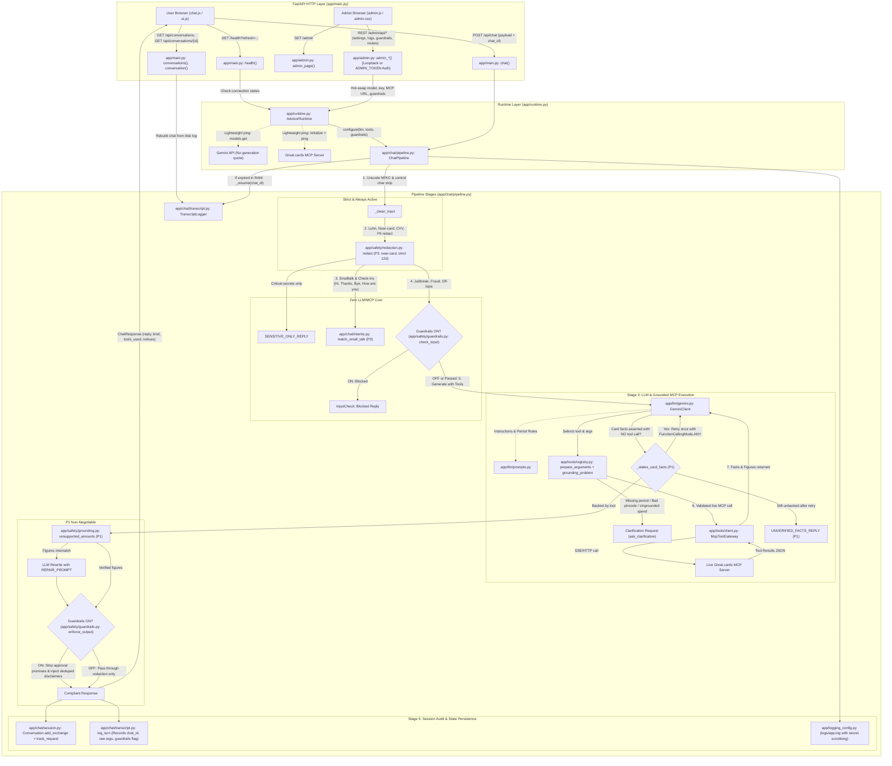

# Great.cards Credit Card Advisor — Complete Codebase Mind Map

This document provides a comprehensive structural and architectural mind map of the entire **Great.cards Credit Card Advisor** repository located at `d:\great-cards`. Every single file, directory, subsystem, and relationship is mapped out below, including all architectural improvements introduced across the **P1**, **P2**, and **P3** safety fixes, the **Spend Period Ambiguity Fix**, the **Modern Multi-Chat Dashboard UI**, the **Unified Health & Admin Monitoring System**, and **Performance / Concurrency Optimizations**.

---

## 1. High-Level Visual Mind Map

```mermaid
mindmap
  root((Great.cards Advisor))
    Infrastructure & Config
      [d:/great-cards/.env.example]
      [d:/great-cards/.env]
      [d:/great-cards/requirements.txt]
      [d:/great-cards/.gitignore]
      [d:/great-cards/README.md]
      [d:/great-cards/inline_text.md]
      [d:/great-cards/failures.md]
      [d:/great-cards/product_owner_note.md]
      [d:/great-cards/codebase_mind_map.md]
      [d:/great-cards/run.bat]
      [d:/great-cards/venv.bat]
    FastAPI Web Core - app/
      [d:/great-cards/app/main.py]
        Unified /health Endpoint
        Multi-chat Conversation Routes
        Admin Router Mounting
      [d:/great-cards/app/admin.py]
        ::icon(fa fa-shield-alt)
        Admin Console UI & REST API
        Loopback & ADMIN_TOKEN Auth
        CSRF Same-Origin Validation
        Live Route Introspection
        Secret Masking (API Keys & URLs)
      [d:/great-cards/app/runtime.py]
        ::icon(fa fa-sliders-h)
        AdvisorRuntime Hot Configuration
        In-Memory Overrides Management
        Lightweight Gemini & MCP Ping Probes
        Non-Quota Health Result Caching
        Runtime Guardrail Toggle
      [d:/great-cards/app/config.py]
        COOKIE_MAX_AGE_SECONDS (30d)
        MAX_LISTED_CHATS (50)
        HEALTH_CACHE_SECONDS (30s)
        GUARDRAILS_ENABLED & ADMIN_TOKEN
      [d:/great-cards/app/schemas.py]
        ChatRequest (with chat_id)
        ChatSummary & ChatHistory Models
        HealthResponse & ServiceStatus Models
      [d:/great-cards/app/logging_config.py]
        Dynamic Secret Redaction Registration
        app.log Rotating File Handler
      [d:/great-cards/app/__init__.py]
    Chat Pipeline - app/chat/
      [d:/great-cards/app/chat/pipeline.py]
        ::icon(fa fa-cogs)
        Card Fact Detection (P1)
        Forced Tool Calling ANY Mode (P1)
        Turn-scoped Allowed Figures (P1)
        Multi-turn Request Tracking (P1)
        Multi-Chat Client chat_id Keying
        Disk Transcript Session Resumption (_resume)
        Runtime Guardrail State Enforcement
      [d:/great-cards/app/chat/session.py]
        Per-chat Conversation Isolation
        pending_request Multi-turn State
      [d:/great-cards/app/chat/intents.py]
        Conversational Check-in Local Intent (P3)
      [d:/great-cards/app/chat/transcript.py]
        ::icon(fa fa-file-text)
        Forensic Tool & Error Logging (P2)
        Disk Transcript Parser (parse_transcript)
        Per-Browser Chat Listing (list_chats)
        Admin Full Transcript Explorer (list_all/load_file)
        Chat Header Tagging & Guardrail Flags
      [d:/great-cards/app/chat/__init__.py]
    Safety & Guardrails - app/safety/
      [d:/great-cards/app/safety/redaction.py]
        Luhn & Near-Card Heuristics (P3)
        Strict 12-Digit Aadhaar (P3)
        Non-Negotiable Privacy Filtering
      [d:/great-cards/app/safety/guardrails.py]
        Broadened Fraud Filter (P3)
        Disclaimer Deduplication (P3)
        Runtime Toggleable check_input & enforce_output
      [d:/great-cards/app/safety/grounding.py]
        Turn-scoped Rupee Grounding (P1)
        Both-ends Range Check (P1)
        Zero-tolerance Hedged Figures (P1)
        Positional Token Spans (number_spans)
        Non-Negotiable Amount Stripping
      [d:/great-cards/app/safety/__init__.py]
    LLM Engine - app/llm/
      [d:/great-cards/app/llm/gemini.py]
        FunctionCallingMode ANY Support (P1)
        Lightweight Ping via models.get
        last_error Observability
      [d:/great-cards/app/llm/prompts.py]
        Tools Required Prompt (P1)
        Caps & Exclusions Grounding Rules (P2)
        Tool Ranking Preservation (P2)
        Assumption Disclosure Rules (P2)
        Spend Period Clarification Directives
      [d:/great-cards/app/llm/__init__.py]
    MCP Tool Gateway - app/tools/
      [d:/great-cards/app/tools/client.py]
        Live MCP Client & TTL Caching
        Lightweight Ping via initialize & send_ping
        Connection State Tracking (reachable, tool_count)
        Background Schema Warmup
      [d:/great-cards/app/tools/registry.py]
        Per-value Spend Grounding (P1)
        whatsapp_compare_cards Exposed (P2)
        Postal Circle Pincode Plausibility (P3)
        Spend Period Extraction (_periods_in)
        Bare Period Sentence Analysis (_BARE_PERIOD_RE)
        Strict Period Multipliers (_PERIOD_FACTOR)
      [d:/great-cards/app/tools/__init__.py]
    Presentation Layer
      Templates
        [d:/great-cards/app/templates/index.html]
          Two-Panel Chat Dashboard
          Sidebar Past Chats & Status Indicators
          Suggestion Chips & Composer
        [d:/great-cards/app/templates/admin.html]
          Admin Dashboard (5 Integrated Panels)
          Overview, History, Settings, Guardrails, Endpoints
      Static Assets
        [d:/great-cards/app/static/css/styles.css]
          Modern Card Theme & Glassmorphism
          Responsive Drawer Layout
          Light & Dark Mode Tokens
        [d:/great-cards/app/static/css/admin.css]
          Admin Console Visual Styling
          Metric Tiles, Logs Tail, Tab Switchers
        [d:/great-cards/app/static/js/ui.js]
          Shared UI Toolkit (Zero Dependency)
          Theme Switcher, Ripple Animation, Toasts, Markdown
        [d:/great-cards/app/static/js/chat.js]
          Multi-Chat State Management
          Live /health Polling (30s)
          Transcript Loading & Local Caching
        [d:/great-cards/app/static/js/admin.js]
          Real-time Health Checking
          Transcript Viewer (Conversation vs Raw)
          Hot Configuration Mutation
          Guardrail Confirmation Modals
          Dynamic Route Filtering
    Testing & QA - tests/
      [d:/great-cards/tests/test_spend_period.py]
        16 Offline Regression Checks
        Unstated Spend Period Clarification
        Period-matched Multiplier Enforcement
        P1 Grounding Preservation
    Runtime Artifacts
      [logs/app.log]
      [logs/sessions/*.log]
```



---

## 2. End-to-End Pipeline & System Data Flow

The diagram below traces how user and administrator actions flow across the entire system, highlighting health probes, runtime reconfiguration, session resumption, and multi-stage safety checkpoints:



---

## 3. Detailed File Catalog & Symbol Directory

### 3.1. Project Root & Infrastructure

| File | Purpose & Responsibility | Key Contents / Exports | Relevant Milestones |
|---|---|---|---|
| [README.md](file:///d:/great-cards/README.md) | Complete developer and user documentation | Setup, pipeline breakdown, Admin console documentation, health monitoring, session transcript schema, folder structure. | Updated across all milestones |
| [requirements.txt](file:///d:/great-cards/requirements.txt) | Python dependencies | `fastapi`, `uvicorn`, `jinja2`, `python-dotenv`, `pydantic`, `httpx`, `mcp`, `google-genai`, `jsonschema`. | Baseline |
| [.env.example](file:///d:/great-cards/.env.example) | Environment template | Variables: `MCP_URL`, `LLM_PROVIDER`, `LLM_MODEL`, `GEMINI_API_KEY`, `LLM_TIMEOUT_SECONDS`, `GUARDRAILS_ENABLED`, `ADMIN_TOKEN`. | Updated in Admin/Health |
| [.env](file:///d:/great-cards/.env) | Local environment secrets (untracked) | Live API keys, server URLs, and admin authorization token. | Protected |
| [.gitignore](file:///d:/great-cards/.gitignore) | Git exclusion patterns | Excludes `.env`, `venv/`, `logs/`, `__pycache__/`, `.pytest_cache/`. | Baseline |
| [inline_text.md](file:///d:/great-cards/inline_text.md) | Comprehensive project build & conversation log | Chronological record of prompts, implementation details, and verification reports. | Maintained across all iterations |
| [failures.md](file:///d:/great-cards/failures.md) | Systematic failure analysis report | Comprehensive 20-question audit evaluating guardrail compliance, tool selection, and grounding. | Baseline audit reference |
| [product_owner_note.md](file:///d:/great-cards/product_owner_note.md) | Executive brief to Product Owner (~1 page) | Plain-language executive note covering ungrounded failure modes, fixes, quality-vs-latency trade-offs, ranked MCP backlog, and Redis architecture. | Final submission deliverable |
| [codebase_mind_map.md](file:///d:/great-cards/codebase_mind_map.md) | Visual & structural codebase mind map | Architectural and relationship blueprint of the repository. | Maintained current |
| [run.bat](file:///d:/great-cards/run.bat) | Windows launcher script | Starts FastAPI application via `uvicorn app.main:app --reload`. | Convenience script |
| [venv.bat](file:///d:/great-cards/venv.bat) | Virtual environment activation script | Activates local virtual environment (`venv\scripts\activate`). | Convenience script |

---

### 3.2. Application Core, Admin & Runtime (`app/`)

| File | Purpose & Responsibility | Key Symbols / Classes | Relevant Milestones |
|---|---|---|---|
| [app/__init__.py](file:///d:/great-cards/app/__init__.py) | Package initialization | Marks `app` as a Python package. | Baseline |
| [app/main.py](file:///d:/great-cards/app/main.py) | Application entrypoint, FastAPI wiring, HTTP routes & lifecycle | [`lifespan()`](file:///d:/great-cards/app/main.py#L44), [`index()`](file:///d:/great-cards/app/main.py#L105), [`chat()`](file:///d:/great-cards/app/main.py#L116), [`reset()`](file:///d:/great-cards/app/main.py#L130), [`conversations()`](file:///d:/great-cards/app/main.py#L139), [`conversation()`](file:///d:/great-cards/app/main.py#L147), [`health()`](file:///d:/great-cards/app/main.py#L162), [`_session_id()`](file:///d:/great-cards/app/main.py#L80), security headers middleware. | Admin & Health, Multi-Chat UI |
| [app/admin.py](file:///d:/great-cards/app/admin.py) | Admin console router, access control, route introspection & API endpoints | [`router`](file:///d:/great-cards/app/admin.py#L39), [`require_admin`](file:///d:/great-cards/app/admin.py#L78), [`mask_key`](file:///d:/great-cards/app/admin.py#L91), [`mask_url`](file:///d:/great-cards/app/admin.py#L97), [`ConnectionSettings`](file:///d:/great-cards/app/admin.py#L110), [`GuardrailsUpdate`](file:///d:/great-cards/app/admin.py#L135), [`LoginRequest`](file:///d:/great-cards/app/admin.py#L139), [`_discover_routes()`](file:///d:/great-cards/app/admin.py#L216), [`admin_page()`](file:///d:/great-cards/app/admin.py#L263), [`admin_overview()`](file:///d:/great-cards/app/admin.py#L297), [`admin_chats()`](file:///d:/great-cards/app/admin.py#L313), [`admin_chat()`](file:///d:/great-cards/app/admin.py#L320), [`admin_app_log()`](file:///d:/great-cards/app/admin.py#L333), [`admin_update_settings()`](file:///d:/great-cards/app/admin.py#L347), [`admin_test_settings()`](file:///d:/great-cards/app/admin.py#L355), [`admin_set_guardrails()`](file:///d:/great-cards/app/admin.py#L375). | Admin Dashboard |
| [app/runtime.py](file:///d:/great-cards/app/runtime.py) | Dynamic runtime management, in-memory configuration & health probing | [`AdvisorRuntime`](file:///d:/great-cards/app/runtime.py#L38) (`start`, `overrides`, `update_connection`, `reset_connection`, `set_guardrails`, `health`, `test_connection`), [`_check_llm()`](file:///d:/great-cards/app/runtime.py#L190), [`_check_mcp()`](file:///d:/great-cards/app/runtime.py#L213). | Admin Dashboard, Unified Health |
| [app/config.py](file:///d:/great-cards/app/config.py) | Centralized configuration, fixed limits & env loader | [`Settings`](file:///d:/great-cards/app/config.py#L57), [`get_settings()`](file:///d:/great-cards/app/config.py#L86), constants: `MAX_MESSAGE_CHARS` (1000), `MAX_TOOL_STEPS` (4), `HISTORY_MESSAGES` (12), `SESSION_TTL_SECONDS` (3600), `COOKIE_MAX_AGE_SECONDS` (30 days), `MAX_LISTED_CHATS` (50), `MCP_TIMEOUT_SECONDS` (45.0), `HEALTH_CACHE_SECONDS` (30), `HEALTH_TIMEOUT_SECONDS` (10.0). | Multi-Chat UI, Admin System |
| [app/schemas.py](file:///d:/great-cards/app/schemas.py) | Pydantic HTTP request and response models | [`ChatRequest`](file:///d:/great-cards/app/schemas.py#L12) (with `chat_id`), [`ChatResponse`](file:///d:/great-cards/app/schemas.py#L25), [`ChatSummary`](file:///d:/great-cards/app/schemas.py#L32), [`ChatMessage`](file:///d:/great-cards/app/schemas.py#L40), [`ChatHistory`](file:///d:/great-cards/app/schemas.py#L49), [`ServiceStatus`](file:///d:/great-cards/app/schemas.py#L56), [`HealthResponse`](file:///d:/great-cards/app/schemas.py#L64). | Multi-Chat UI, Unified Health |
| [app/logging_config.py](file:///d:/great-cards/app/logging_config.py) | Security-aware logging setup & secret scrubbing | [`RedactingFilter`](file:///d:/great-cards/app/logging_config.py#L15), [`register_secrets()`](file:///d:/great-cards/app/logging_config.py#L31), [`configure_logging()`](file:///d:/great-cards/app/logging_config.py#L40), [`scrub()`](file:///d:/great-cards/app/logging_config.py#L48). | Baseline, Admin System |

---

### 3.3. Chat Pipeline & State (`app/chat/`)

| File | Purpose & Responsibility | Key Symbols / Classes | Relevant Milestones |
|---|---|---|---|
| [app/chat/__init__.py](file:///d:/great-cards/app/chat/__init__.py) | Package marker | Empty package marker. | Baseline |
| [app/chat/pipeline.py](file:///d:/great-cards/app/chat/pipeline.py) | Core 10-stage orchestration pipeline | [`ChatPipeline`](file:///d:/great-cards/app/chat/pipeline.py#L87) (`handle`, `configure`, `_resume`, `reset`, `_respond`, `_run_agent`, `_allowed_figures`, `_finish`, `_execute`), [`_states_card_facts()`](file:///d:/great-cards/app/chat/pipeline.py#L62), `_CARD_FACT_RE`, `UNVERIFIED_FACTS_REPLY`, [`ChatReply`](file:///d:/great-cards/app/chat/pipeline.py#L67), [`_ToolOutcome`](file:///d:/great-cards/app/chat/pipeline.py#L75), [`_clean_input()`](file:///d:/great-cards/app/chat/pipeline.py#L81). | **P1**: Forced tool calling, figure grounding.<br>**P2**: Raw args & execution traces.<br>**P3**: Hardened filters.<br>**Multi-Chat**: `_resume` from transcripts, `chat_id` routing.<br>**Admin**: Hot `configure`. |
| [app/chat/session.py](file:///d:/great-cards/app/chat/session.py) | In-memory conversation store & concurrency isolation | [`Conversation`](file:///d:/great-cards/app/chat/session.py#L18) (`history`, `lock`, `turn_count`, `log_path`, `chat_id`, `pending_request`, `track_request`, `request_text`), [`SessionStore`](file:///d:/great-cards/app/chat/session.py#L51). | **P1**: Multi-turn request assembly.<br>**Multi-Chat**: `chat_id` support per conversation. |
| [app/chat/intents.py](file:///d:/great-cards/app/chat/intents.py) | Fast local pattern-matching for zero-cost small talk | [`match_small_talk()`](file:///d:/great-cards/app/chat/intents.py#L53), `_INTENTS` regex tuple (greetings, conversational check-ins, menu/help, thanks, goodbye), `_CAPABILITIES`. | **P3**: Added conversational check-in patterns ("how are you", "what's up"). |
| [app/chat/transcript.py](file:///d:/great-cards/app/chat/transcript.py) | Per-session forensic transcripts in `logs/sessions/` & parsing engine | [`TranscriptLogger`](file:///d:/great-cards/app/chat/transcript.py#L62) (`log_turn`, `log_event`, `list_chats`, `list_all`, `load_file`, `load_chat`, `set_model`), [`TurnTrace`](file:///d:/great-cards/app/chat/transcript.py#L31), [`LoggedTurn`](file:///d:/great-cards/app/chat/transcript.py#L223), [`LoggedChat`](file:///d:/great-cards/app/chat/transcript.py#L237), [`parse_transcript()`](file:///d:/great-cards/app/chat/transcript.py#L287). | **P2**: Raw arguments & 2KB detail traces.<br>**Multi-Chat**: Transcript parser, per-browser history reader.<br>**Admin**: Full transcript explorer (`list_all`, `load_file`). |

---

### 3.4. Safety, Redaction & Grounding (`app/safety/`)

| File | Purpose & Responsibility | Key Symbols / Classes | Relevant Milestones |
|---|---|---|---|
| [app/safety/__init__.py](file:///d:/great-cards/app/safety/__init__.py) | Package marker | Empty package marker. | Baseline |
| [app/safety/redaction.py](file:///d:/great-cards/app/safety/redaction.py) | Local PII & financial secret scrub (Luhn-verified) | [`redact()`](file:///d:/great-cards/app/safety/redaction.py#L137), [`has_meaningful_content()`](file:///d:/great-cards/app/safety/redaction.py#L156), [`_luhn_valid()`](file:///d:/great-cards/app/safety/redaction.py#L34), [`RedactionResult`](file:///d:/great-cards/app/safety/redaction.py#L18), rules for card numbers, CVV, OTP, PIN, passwords, bank accounts, emails, UPI IDs, phone numbers, Aadhaar, PAN. | **P3**: Strict 12-digit Aadhaar pattern; near-card 13–19 digit redaction even if Luhn fails. Non-negotiable security. |
| [app/safety/guardrails.py](file:///d:/great-cards/app/safety/guardrails.py) | Pre-LLM input security & Post-LLM output compliance | [`check_input()`](file:///d:/great-cards/app/safety/guardrails.py#L93) (injection, fraud, tax, off-topic detection), [`enforce_output()`](file:///d:/great-cards/app/safety/guardrails.py#L135) (strips approval promises, injects statutory disclaimers), [`InputCheck`](file:///d:/great-cards/app/safety/guardrails.py#L85). | **P3**: Widened fraud regex; disclaimer deduplication.<br>**Admin**: Controlled via runtime toggle (`guardrails_enabled`). |
| [app/safety/grounding.py](file:///d:/great-cards/app/safety/grounding.py) | Hallucination defence for Rupee (₹) figures | [`number_spans()`](file:///d:/great-cards/app/safety/grounding.py#L32), [`numbers_in()`](file:///d:/great-cards/app/safety/grounding.py#L51) (unit parsing: k, lac, lakh, lpa, cr; range ends via `_AMOUNT_RE`), [`expand_evidence()`](file:///d:/great-cards/app/safety/grounding.py#L65), [`unsupported_amounts()`](file:///d:/great-cards/app/safety/grounding.py#L91), [`strip_unsupported_amounts()`](file:///d:/great-cards/app/safety/grounding.py#L105). | **P1**: Strict turn-scoped allowed figures; range and hedged figure zero-tolerance.<br>**Spend Period**: Added `number_spans` for positional token matching. |

---

### 3.5. LLM Integration (`app/llm/`)

| File | Purpose & Responsibility | Key Symbols / Classes | Relevant Milestones |
|---|---|---|---|
| [app/llm/__init__.py](file:///d:/great-cards/app/llm/__init__.py) | Package marker | Empty package marker. | Baseline |
| [app/llm/gemini.py](file:///d:/great-cards/app/llm/gemini.py) | Google GenAI SDK wrapper with function calling & ping | [`GeminiClient`](file:///d:/great-cards/app/llm/gemini.py#L97) (`generate`, `ping`, `aclose`), [`LLMError`](file:///d:/great-cards/app/llm/gemini.py#L21), [`build_tool()`](file:///d:/great-cards/app/llm/gemini.py#L48), [`to_gemini_schema()`](file:///d:/great-cards/app/llm/gemini.py#L27), response parsers: `function_calls`, `response_text`, `function_response_part`. | **P1**: `require_tool_call` parameter (`FunctionCallingMode.ANY`).<br>**Unified Health**: Lightweight `ping()` via `models.get()`; `last_error` tracking. |
| [app/llm/prompts.py](file:///d:/great-cards/app/llm/prompts.py) | System prompt templates & Clarification tool schema | [`build_system_prompt()`](file:///d:/great-cards/app/llm/prompts.py#L125) (injects advisor playbook + dynamic safety flags), `CLARIFY_DECLARATION` (`ask_clarification`), `REPAIR_PROMPT`, `TOOLS_REQUIRED_PROMPT`. | **P1**: Tools required prompt.<br>**P2**: Caps/exclusions, ranking preservation, assumptions.<br>**Spend Period**: Anti-assumption rules for monthly vs annual periods. |

---

### 3.6. MCP Tools Integration (`app/tools/`)

| File | Purpose & Responsibility | Key Symbols / Classes | Relevant Milestones |
|---|---|---|---|
| [app/tools/__init__.py](file:///d:/great-cards/app/tools/__init__.py) | Package marker | `# pyrefly: ignore [missing-import]` | Baseline |
| [app/tools/client.py](file:///d:/great-cards/app/tools/client.py) | Async client for live Great.cards MCP server | [`McpToolGateway`](file:///d:/great-cards/app/tools/client.py#L94) (`open_session`, `connection`, `catalog`, `ping`, `warm_up`, properties: `tool_count`, `loading`, `advisor_context`), [`ToolConnection`](file:///d:/great-cards/app/tools/client.py#L62), [`ToolResult`](file:///d:/great-cards/app/tools/client.py#L40), [`ToolServiceError`](file:///d:/great-cards/app/tools/client.py#L35). | **Unified Health**: Added `ping()` (`initialize` + `send_ping`), `reachable` and `tool_count` state variables. |
| [app/tools/registry.py](file:///d:/great-cards/app/tools/registry.py) | Schema filtering, type coercion, pincode check & period-aware spend validation | [`ToolSpec`](file:///d:/great-cards/app/tools/registry.py#L51), [`ToolCatalog`](file:///d:/great-cards/app/tools/registry.py#L82), [`prepare_arguments()`](file:///d:/great-cards/app/tools/registry.py#L120), [`grounding_problem()`](file:///d:/great-cards/app/tools/registry.py#L163), [`_ungrounded_spends()`](file:///d:/great-cards/app/tools/registry.py#L195), [`_periods_in()`](file:///d:/great-cards/app/tools/registry.py#L257), [`_stated_amounts()`](file:///d:/great-cards/app/tools/registry.py#L279), `_BARE_PERIOD_RE`, `_PERIOD_FACTOR`, `EXPOSED_TOOLS`, `RESTRICTED_ENUMS`. | **P1**: Per-value spend grounding.<br>**P2**: `whatsapp_compare_cards` exposed.<br>**P3**: Postal circle pincode check (11–85).<br>**Spend Period**: Contextual period detection, strict conversion matching. |

---

### 3.7. Presentation Layer (`app/templates/` & `app/static/`)

| File | Purpose & Responsibility | Key Symbols / Elements | Relevant Milestones |
|---|---|---|---|
| [app/templates/index.html](file:///d:/great-cards/app/templates/index.html) | Modern interactive AI chat dashboard | Sidebar with New chat button, live status indicators (LLM & MCP), past chat transcript list, suggestion chips, chat message scroll container, privacy notice badge. | Multi-Chat Dashboard UI |
| [app/templates/admin.html](file:///d:/great-cards/app/templates/admin.html) | Full-featured Admin Console dashboard | Navigation for 5 sections: Overview, Chat History & Logs, Model & API Settings, Guardrails, and All Endpoints; modal dialogues, log tail viewer, token sign-in. | Admin Dashboard |
| [app/static/css/styles.css](file:///d:/great-cards/app/static/css/styles.css) | Custom styling, design tokens & responsive layout | HSL color tokens, dark/light themes, card bubbles, suggestion chips, typing indicators, drawer transitions, ripple effects. | Modern UI Redesign |
| [app/static/css/admin.css](file:///d:/great-cards/app/static/css/admin.css) | Admin dashboard styling | Stat tiles, metric bars, transcript raw/parsed view, log tail container, toggle switches, modal sheets. | Admin Dashboard |
| [app/static/js/ui.js](file:///d:/great-cards/app/static/js/ui.js) | Shared, zero-dependency UI toolkit (`window.GCUI`) | Theme management (`initTheme`), safe inline markdown parser (`renderMarkdown`), table renderer, toasts (`showToast`), button ripple animations (`attachRipple`). | UI Modularization |
| [app/static/js/chat.js](file:///d:/great-cards/app/static/js/chat.js) | Frontend chat dashboard client | Multi-chat state manager, dynamic transcript loading via `/api/conversations`, 30s `/health` polling, auto-resizing composer, keyboard shortcuts. | Multi-Chat Dashboard UI |
| [app/static/js/admin.js](file:///d:/great-cards/app/static/js/admin.js) | Admin dashboard frontend logic | Section hash routing, real-time metrics, live log tailing, in-memory settings updates, guardrails confirmation flow, endpoint table search. | Admin Dashboard |

---

### 3.8. Testing & Quality Assurance (`tests/`)

| File | Purpose & Responsibility | Key Checks / Test Cases | Relevant Milestones |
|---|---|---|---|
| [tests/test_spend_period.py](file:///d:/great-cards/tests/test_spend_period.py) | Offline unit & regression test suite (16 tests) | `PeriodNotStated` (unstated periods rejected, savings word ignored, MCP call blocked); `PeriodEstablished` (stated monthly/annual, sentence sharing, clarifying question reply, MCP call allowed); `P1GroundingPreserved` (invented amounts and fabricated savings caught). | Spend Period Ambiguity Fix |

---

### 3.9. Data & Reference (`data/`)

| File | Purpose & Responsibility | Key Details | Relevant Milestones |
|---|---|---|---|
| [data/mcp_tools.json](file:///d:/great-cards/data/mcp_tools.json) | Offline schema snapshot of the 14 Great.cards MCP tools | Reference tool schemas for WhatsApp facades, `recommend_cards`, `list_cards`, `get_card_details`, `compare_cards`, `check_eligibility`, `generate_content_brief`, and `get_advisor_context`. | Offline schema reference & test fixture |

---

## 4. Subsystem Relationship & Architectural Summary

```
+---------------------------------------------------------------------------------------+
|                                  Presentation Layer                                   |
|   Chat Dashboard: index.html | chat.js          Admin Console: admin.html | admin.js  |
|                                                                                       |
|                   Shared Toolkit: ui.js (Theme, Ripple, Markdown, Toast)              |
|                   Design System:  styles.css (Tokens) | admin.css                     |
+-------------------------------------------+-------------------------------------------+
                                            | (HTTP / JSON / Same-Origin / Cookies)
                                            v
+---------------------------------------------------------------------------------------+
|                               FastAPI Application Core                                |
|                                   app/main.py                                         |
|   Public Routes: / | /api/chat | /api/conversations | /health                         |
|   Admin Router:  /admin | /admin/api/* (app/admin.py: Loopback / ADMIN_TOKEN Auth)    |
|   Data Schemas:  app/schemas.py (Pydantic Models)                                     |
|   Log Auditing:  app/logging_config.py (RedactingFilter -> logs/app.log)              |
+-------------------------------------------+-------------------------------------------+
                                            |
                                            v
+---------------------------------------------------------------------------------------+
|                               Runtime Management Layer                                |
|                                  app/runtime.py                                       |
|   AdvisorRuntime: Hot-swaps settings in RAM; lightweight probes (models.get & ping)    |
|   Security: Dynamic secret registration (API keys & URLs masked before disk write)     |
+-------------------------------------------+-------------------------------------------+
                                            |
                                            v
+---------------------------------------------------------------------------------------+
|                               Chat Orchestration Layer                                |
|                                 app/chat/pipeline.py                                  |
|   State & Isolation: app/chat/session.py (Conversation keyed by cookie:chat_id)       |
|   Persistence:       app/chat/transcript.py (Disk transcript logger & parser)        |
|   Resumption:        Automatic conversation rebuild from transcript on RAM expiry     |
+--------------------+---------------------------------------------+--------------------+
                     |                                             |
                     v                                             v
+-------------------------------------------+ +-----------------------------------------+
|            Safety & Guardrails            | |               LLM Engine                |
| app/safety/redaction.py (Luhn + PII)      | | app/llm/gemini.py (Function calling)    |
| app/safety/guardrails.py (Runtime toggle) | | app/llm/prompts.py (Playbook & rules)   |
| app/safety/grounding.py (Rupee grounding) | +-----------------------------------------+
+-------------------------------------------+                      |
                     |                                             v
                     +----------------------------> +-----------------------------------+
                                                    |         MCP Tool Gateway          |
                                                    | app/tools/client.py (Live client) |
                                                    | app/tools/registry.py (Period check|
                                                    +-----------------------------------+
                                                                   |
                                                                   v
                                                    +-----------------------------------+
                                                    |     Live Great.cards Server       |
                                                    +-----------------------------------+
```

---

## 5. Complete Architectural Milestones & Fixes Cross-Reference

| Milestone / Fix ID | Problem Statement & Objective | Resolution & Technical Implementation | Modules Changed |
|---|---|---|---|
| **P1-1** | Unsupported ₹ figures leaking through session evidence pool, range ends, and hedged amounts | Restricted allowed numbers strictly to **this turn's tool results + user's current request numbers**. Removed session-wide `evidence`. Tool numbers not 12x converted. Checked both ends of range (`-`, `–`, `to`). 0% tolerance on hedged figures. | `safety/grounding.py`<br>`chat/pipeline.py`<br>`chat/session.py`<br>`llm/prompts.py` |
| **P1-2** | Model invented spend categories/amounts (Q4, Q5) | **Per-value grounding**: every positive spend argument in `recommend_cards` must match numbers in `request_text` (allowing ×12/÷12, and ×3/÷4 for lounge). Unstated spends rejected with clarification request. Multi-turn request assembled via `pending_request`. | `tools/registry.py`<br>`chat/session.py`<br>`llm/prompts.py` |
| **P1-3** | Model stated card facts/fees without tool calls (Q11, Q12) | **Heuristic detection & forced tool retry**: `_states_card_facts()` detects unbacked card facts, triggers one re-prompt with `TOOLS_REQUIRED_PROMPT` and `require_tool_call=True` (`FunctionCallingMode.ANY`). Falls back to `UNVERIFIED_FACTS_REPLY` if model persists. | `chat/pipeline.py`<br>`llm/gemini.py`<br>`llm/prompts.py` |
| **P2-4** | Model produced generic "typically" figures for caps and surcharge terms instead of querying card data (Q6, Q7, Q8, Q14) | System prompt instructs calling `get_card_details` for top card recommendations to quote actual terms; forbids generic ranges; mandates preserving ranked tool order. | `llm/prompts.py` |
| **P2-5** | Ambiguous categories triggered guessing instead of clarification (Q2, Q3) | System prompt mandates using `ask_clarification` or explicitly disclosing the split assumption in a single line. | `llm/prompts.py` |
| **P2-6** | Card comparisons with stated spends ignored spend data (Q9) | Added `whatsapp_compare_cards` to `EXPOSED_TOOLS`, routed spend-aware card comparisons to it, and grounded its `spend_profile` via `_ungrounded_spends()`. Tagged in frontend. | `tools/registry.py`<br>`llm/prompts.py`<br>`static/js/chat.js` |
| **P2-7** | Lack of visibility into raw pre-cleaned arguments, schema errors, and tool responses | Transcripts in `logs/sessions/` now record raw (pre-cleaning) arguments, schema validation rejection text, grounding error messages, and truncated tool outputs (up to 2,000 chars). | `chat/transcript.py`<br>`chat/pipeline.py` |
| **P3-8a** | Card number failing Luhn leaked partial digits (Q20) | Redact 13–19 digit groups near the word "card" (within 15 chars) even if Luhn checksum fails. | `safety/redaction.py` |
| **P3-8b** | Spaced 16-digit card mislabeled as Aadhaar, leaking last 4 digits (Q20) | Restricted Aadhaar regex strictly to exact 12-digit patterns so 16-digit groups are not captured as Aadhaar. | `safety/redaction.py` |
| **P3-8c** | Fraud prompts (faking salary documents, extracting funds) escaped local filter (Q19, Q20) | Widened fraud detection regexes: salary/employer/document fabrication window increased to 40 chars; added "lie about income", "steal/siphon/extract" next to money/funds. | `safety/guardrails.py` |
| **P3-8d** | Greeting with pleasantry sent to Gemini (Turn 1 "Hi how are you?") | Added conversational check-in pattern ("how are you", "what's up", etc.) to `match_small_talk()` for zero-cost local reply. | `chat/intents.py` |
| **P3-8e** | Duplicate approval/tax disclaimers rendered in output (Q13) | Dedup check in `enforce_output()` suppresses statutory notes if answer text already includes an explicit disclaimer. | `safety/guardrails.py` |
| **P3-8f** | Implausible postal codes sent to MCP eligibility tool (Q13 "101014") | Pre-MCP postal circle check (11–85) in `grounding_problem()`; rejects implausible pincodes locally and asks user to re-check. | `tools/registry.py` |
| **Spend Period Fix** | Model assumed unstated spend periods were monthly (e.g., ₹10,000 on Myntra assumed monthly, inflating annual savings 12×) | **Period-Aware Grounding**: `_periods_in()` and `_stated_amounts()` determine if amounts are explicitly tagged as monthly or annual. Rejects unstated spend periods with clarification prompt. Enforces strict unit conversion factor `_PERIOD_FACTOR`. Added `number_spans()` in grounding. Added 16 offline regression tests in `test_spend_period.py`. | `tools/registry.py`<br>`safety/grounding.py`<br>`llm/prompts.py`<br>`tests/test_spend_period.py` |
| **Multi-Chat UI Dashboard** | Plain single-turn chat UI; users could not keep separate chat threads or view historical transcripts | **Two-Panel Dashboard**: Added sidebar listing historical conversations read from session transcripts (`parse_transcript`), per-browser `chat_id` isolation, automatic chat resumption from disk logs (`_resume`), live health dots, suggestion chips, light/dark themes, and modular `ui.js` toolkit. | `templates/index.html`<br>`static/css/styles.css`<br>`static/js/chat.js`<br>`static/js/ui.js`<br>`chat/transcript.py`<br>`chat/pipeline.py`<br>`chat/session.py`<br>`schemas.py`<br>`main.py` |
| **Unified Health & Admin Console** | Multiple disconnected status endpoints; no live health probing without token cost; no centralized dashboard for logs, guardrails, and runtime configuration | **Admin Subsystem & Unified Health**: Merged `/api/status` into `/health` featuring lightweight non-quota probes (`models.get` and MCP `ping`). Created `/admin` console with 5 sections (Overview, History/Logs, Settings, Guardrails, Endpoints). Supported hot in-memory settings reload (`AdvisorRuntime`) without touching `.env`. Added loopback/token auth and dynamic route discovery. | `admin.py`<br>`runtime.py`<br>`templates/admin.html`<br>`static/css/admin.css`<br>`static/js/admin.js`<br>`static/js/ui.js`<br>`llm/gemini.py`<br>`tools/client.py`<br>`main.py`<br>`config.py`<br>`schemas.py` |
| **Observability & Error Handling** | Need for secret scrubbing across logs and robust error resilience | Ensured `RedactingFilter` and `register_secrets` strip all runtime keys. Handled graceful UI error toasts, dynamic secret protection, and connection fallback states. | `logging_config.py`<br>`runtime.py`<br>`main.py` |
